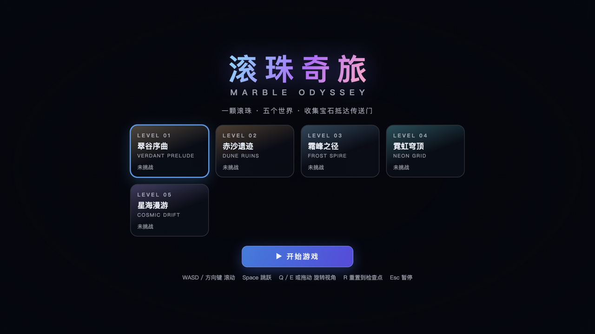
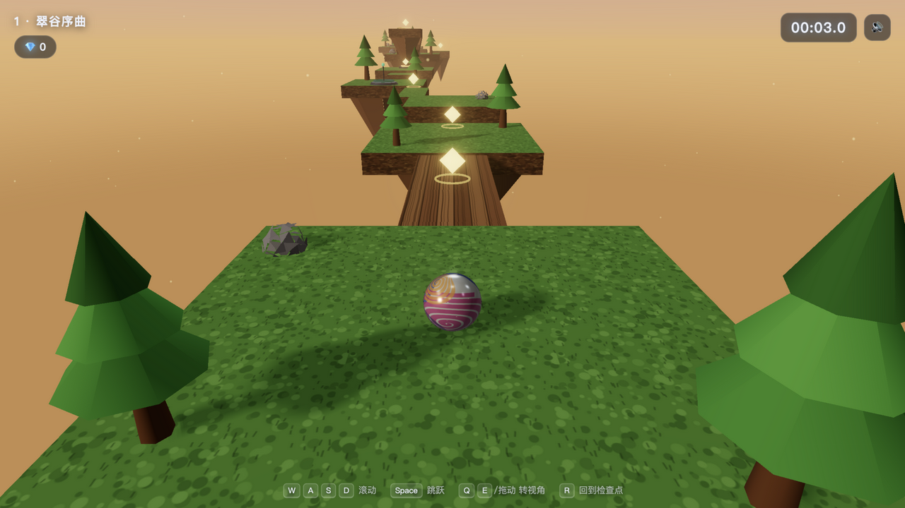
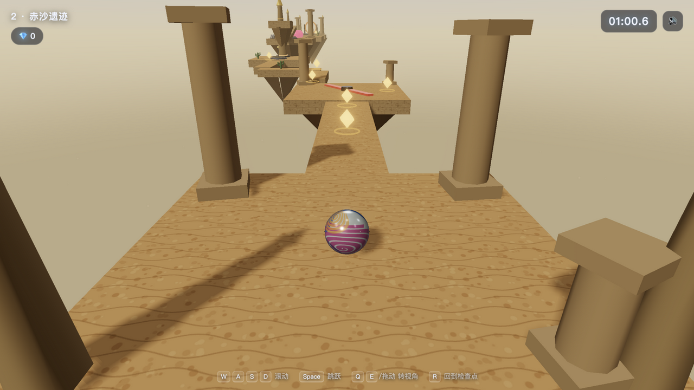
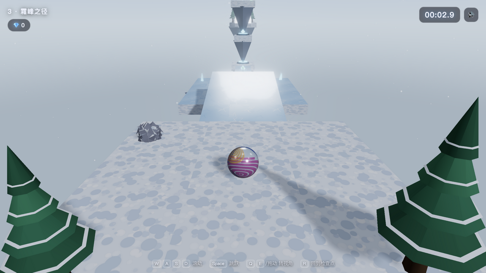
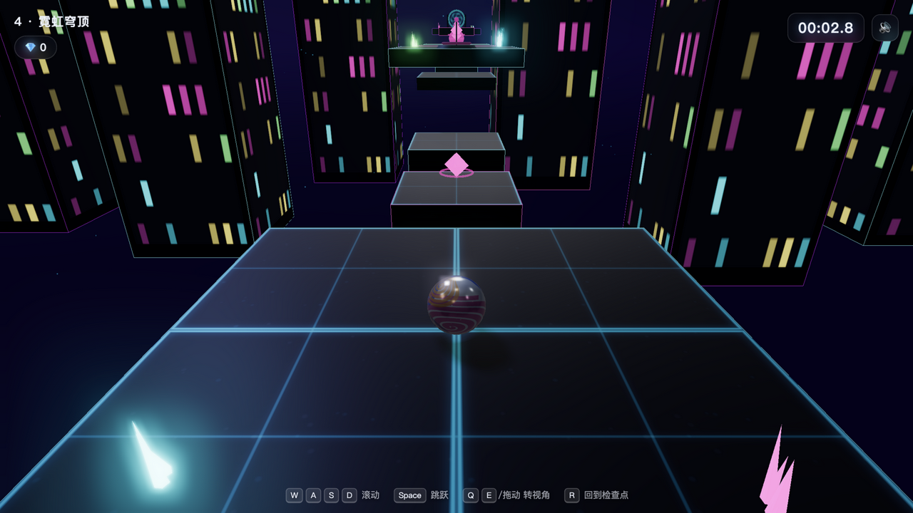
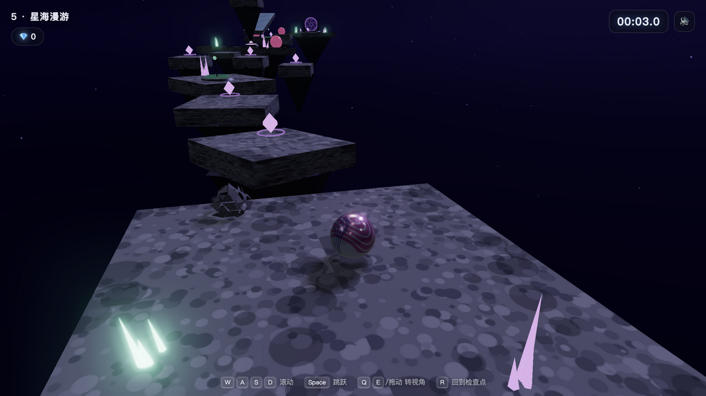
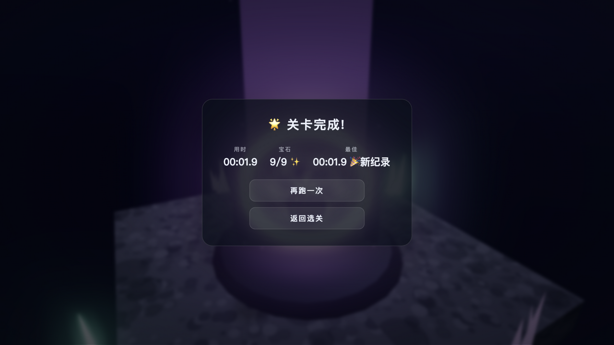

# 滚珠奇旅 · Marble Odyssey

> 一颗滚珠,五个世界。收集宝石,抵达传送门。
> A stylized 3D marble rolling adventure — **Three.js + cannon-es**,零外部素材(贴图全部 Canvas 程序化生成,音效全部 WebAudio 实时合成)。



## ✨ 五个世界

| 关卡 | 主题 | 特色机关 |
|------|------|----------|
| 01 · 翠谷序曲 | 日落草甸浮岛 | 木桥 / 移动平台 / 弹射台 |
| 02 · 赤沙遗迹 | 沙漠神殿 | 旋转护栏 / 碰碰球长廊 / 双移动平台 |
| 03 · 霜峰之径 | 冰面雪原 | 低摩擦冰面 / 弹射登塔 / 极光 |
| 04 · 霓虹穹顶 | 赛博夜城 | 霓虹天台 / 升降电梯 / 光柱传送门 |
| 05 · 星海漫游 | 低重力小行星 | 失重跳跃 / 冰滑梯 / 带环行星 |

| | | |
|---|---|---|
|  |  |  |
|  |  |  |

## 🎮 操作

| 按键 | 功能 |
|------|------|
| `W A S D` / 方向键 | 滚动 |
| `Space` | 跳跃 |
| `Q` / `E` / 鼠标拖动 | 旋转视角 |
| `R` | 回到检查点 |
| `Esc` | 暂停 |
| `M` | 静音 |

📱 移动端自动显示虚拟摇杆 + 跳跃键 + 回点按钮(左侧摇杆移动、右侧跳跃、拖动屏幕转视角);竖屏自动拉宽视场,并针对性降低渲染分辨率 / 阴影贴图 / 粒子数量,帧率过低时自适应降档。

## 🕹 玩法

- 收集关卡内**全部宝石** → 传送门开启 → 冲入传送门通关
- 通关计时,最佳成绩保存在本地(localStorage)
- 路过绿色光环可激活**检查点**,坠落自动回到最近检查点
- 弹射台(橙色)、碰碰球(粉色)都是好朋友(大概)

## 🚀 运行

```bash
npm install
npm run dev      # http://localhost:5173
npm run build    # 构建到 dist/
npm run preview  # 预览构建产物
```

## 🧰 技术栈(全部来自 GitHub 开源项目)

- [three.js](https://github.com/mrdoob/three.js) — 渲染(Bloom 后期 / PCFSoft 阴影 / ACES 色调映射)
- [cannon-es](https://github.com/pmndrs/cannon-es) — 刚体物理(滚动 / 摩擦 / 运动学平台)
- [Vite](https://github.com/vitejs/vite) — 构建工具

**零素材依赖**:所有贴图(草地 / 沙地 / 冰面 / 霓虹格 / 大理石滚珠)由 Canvas 2D 程序化生成;天空是自定义 GLSL 渐变穹顶(太阳 / 星空 / 极光);音效与背景 pad 由 WebAudio 振荡器实时合成。

## 📁 结构

```
src/
├── core/
│   ├── Game.js          # 主循环 / 状态机 / 触发判定
│   ├── PhysicsWorld.js  # cannon-es 封装
│   ├── LevelBuilder.js  # 声明式关卡搭建 API
│   ├── CameraRig.js     # 跟随相机 + 开场运镜
│   ├── Input.js         # 键鼠 / 触屏摇杆
│   ├── Audio.js         # WebAudio 合成音效
│   ├── Sky.js           # GLSL 天空 / 星空 / 极光
│   ├── Particles.js     # 环境粒子 / 爆发 / 拖尾
│   ├── Decorations.js   # 树 / 岩 / 方尖碑 / 霓虹楼 …
│   └── Textures.js      # Canvas 程序化贴图
├── entities/            # 滚珠 / 宝石 / 传送门 / 移动平台 …
├── levels/              # 五个关卡的声明式定义
└── ui/UI.js             # 菜单 / HUD / 通关面板
```

## 📄 License

MIT
